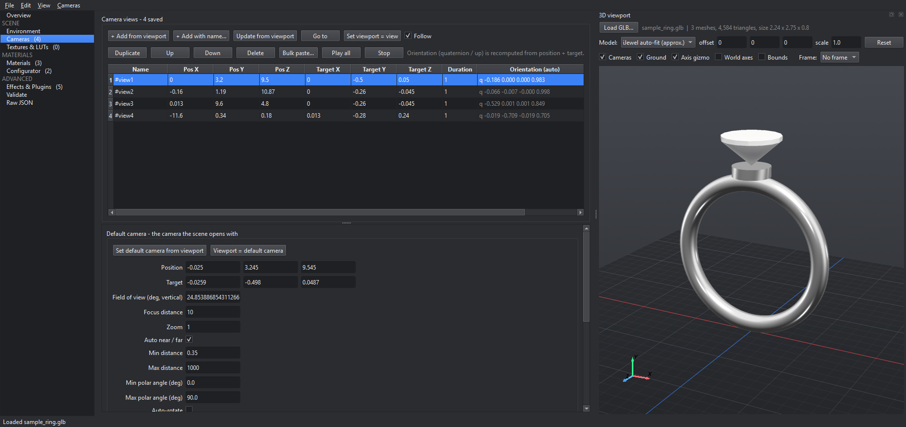

# vjson Studio 3D — iJewel3D vjson editor with a 3D camera viewport

A free, open-source **Windows desktop editor for iJewel3D / WebGi `.vjson` scene files**.
Load any `.glb` jewellery model, orbit around it, and **add, update, preview and delete
iJewel3D camera views** straight from what you see in the 3D viewport. Materials, the
Material Configurator, environment, effects and every other part of the scene can be
edited too — with undo, validation and a save that never damages the file.



> Independent community tool. Not affiliated with, endorsed by or supported by iJewel3D or WebGi.

## Download

Get **`vjson-Studio-3D-Setup-x.y.z.exe`** from the [latest release](https://github.com/vaibhav-1509/ijewel-vjson-studio/releases/latest)
and run it. No admin rights needed (it installs for the current user; pick "all users" in the
wizard if you prefer). Windows 10/11, 64-bit.

> The installer is not code-signed yet, so Windows SmartScreen may say *"Windows protected your PC"*.
> Click **More info → Run anyway**. You can check the download against the SHA-256 on the release page.

## Features

**Camera views from the viewport**
- Load a `.glb` (Draco-compressed files from iJewel / Blender are supported) and orbit, pan, zoom.
- **Add view from viewport** (Ctrl+Shift+A), **Update selected view** (Ctrl+Shift+U),
  **Go to** a view with iJewel-style easing (Ctrl+Shift+G), **Play all** views in order (Ctrl+Shift+P).
- Every saved view is drawn as a camera frustum with its name; click one to select it.
- Aspect-ratio **frame overlay** (1:1, 4:3, 16:9, …) using iJewel's vertical field of view.
- Quaternion and up vector are computed for you (three.js `lookAt`, Y up) — you only deal with
  position and target.
- Set the scene's default (opening) camera from the viewport.
- Ground grid and axis gizmo, like a 3D package.

**Scene editing**
- Spreadsheet-style tables: type in a cell, Enter commits and moves down; copy rows to Excel.
- **Materials**: add, clone, rename, recolour, delete; bulk paste from Excel; the standard set
  (4 metals + `mainstone-<shape>-<colour>`, 207 names) in one click, never duplicated.
- **Material Configurator**: new materials are registered automatically (iJewel3D ignores
  unregistered materials); titles stay unique; renaming keeps a 1:1 title in sync.
- Environment, tone mapping, ground, gem environment map, every plugin's parameters, textures and LUTs.
- **Validate** finds duplicate titles, broken links, unregistered materials, bad colours — most with a one-click fix.
- Undo / redo, light and dark theme, drag-and-drop files onto the window.

**A save you can trust**
- Opening and saving a file with no edits gives a **byte-identical** file — numbers keep their
  exact formatting, key order is kept, base64 LUT data is never touched.
- The first save keeps a `.bak` of the original; writes go through a temporary file.

One `.vjson` usually serves many models: GLB material names are matched against the
configurator titles, so the viewport colours any compatible model from the vjson's materials.

## Using the viewport

| | |
|---|---|
| Orbit / pan / zoom | left drag / middle drag / wheel |
| Add view from what you see | Ctrl+Shift+A |
| Update the selected view | Ctrl+Shift+U |
| Fly to the selected view | Ctrl+Shift+G |
| Play all views / stop | Ctrl+Shift+P / Esc |

Moving the viewport never changes a saved view until you press an update button. With
**Follow** on, selecting or editing a view moves the viewport to it.

**About model position.** iJewel3D re-centres a model and scales it to roughly radius 2 when it
loads it, so a raw GLB does not sit where the saved views expect. The viewport applies the same
kind of fit by default (*iJewel auto-fit*). If the camera frustums miss the model, nudge the
model offset / scale at the top of the viewport — this is display-only, remembered per GLB,
and never written into the `.vjson`. The fit is an approximation: check important views in iJewel3D.

## Run from source

Requires Python 3.11+ on Windows.

```
git clone https://github.com/vaibhav-1509/ijewel-vjson-studio
cd ijewel-vjson-studio
python -m venv .venv
.venv\Scripts\python -m pip install -e ".[test]"
.venv\Scripts\python -m vjson_studio [scene.vjson] [model.glb]
```

Tests (use the synthetic sample in `tests/fixtures/`; set `VJSON_SAMPLES` to a folder of real
`.vjson` files to also round-trip those):

```
.venv\Scripts\python -m pytest -q
```

### Build the installer

```
.venv\Scripts\python -m pip install -e ".[build]"
cd packaging
..\.venv\Scripts\pyinstaller vjson_studio.spec --noconfirm --distpath ..\dist --workpath ..\build
"%LOCALAPPDATA%\Programs\Inno Setup 6\ISCC.exe" installer.iss
```

The installer lands in `dist\`. Inno Setup 6 is free: `winget install JRSoftware.InnoSetup`.

## Project layout

```
vjson_studio/model/     no-GUI core: byte-exact JSON writer, document + undo, cameras, materials, validation
vjson_studio/viewport/  GLB + Draco loader, viewport maths, the pyvista/VTK widget
vjson_studio/ui/        main window, viewport panel, one file per editor section
tests/                  model tests and end-to-end GUI tests (pytest-qt)
packaging/              PyInstaller spec, Inno Setup script, icon
```

## Roadmap

- CSV import: load materials from a CSV, and apply one CSV of changes to many `.vjson` files at once.
- Gem rendering closer to iJewel's shader (currently plain PBR).

Issues and pull requests are welcome.

## License

[MIT](LICENSE) © 2026 Vaibhav H
